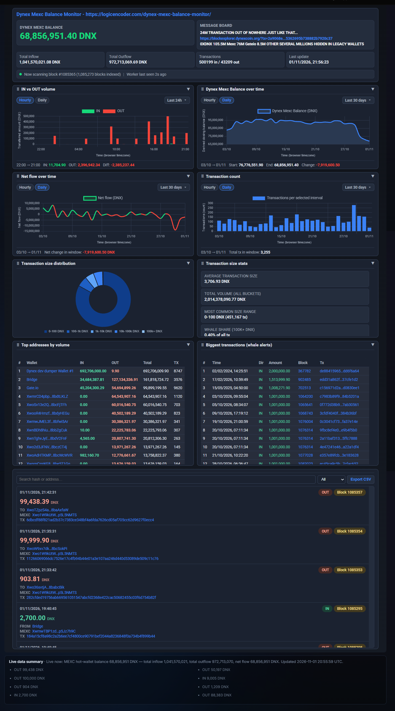

# Dynex MEXC Balance Monitor

Exchange balances move the Dynex market, and the movements are easy to miss in a chain explorer. Dynex MEXC Balance Monitor is a WordPress dashboard that shows the DNX balance held by the monitored MEXC wallet, every deposit and withdrawal as a live feed, and charts of net flow, volume and balance over time.

The data about how much DNX the exchange wallet holds and moves was not published anywhere else; only its creator had it. The monitor was built to make those flows visible to everyone, and it runs on the creator's own site.

Holders and analysts read the dashboard to see whether coins are arriving at the exchange or leaving it. Site owners place it with one shortcode and tune the thresholds, colours and access rules from a settings page.

Open the [live dashboard](https://logicencoder.com/dynex-mexc-balance-monitor/).

## Tech stack

| Layer | Technologies |
|---|---|
| Plugin | PHP 8 and WordPress 6.4, a shortcode, a REST API and an admin settings page |
| Data worker | A Python worker that scans every confirmed block and posts summaries to the plugin |
| Interface | JavaScript and CSS, Chart.js charts served from the plugin itself |
| Live updates | WebSocket push with an AJAX polling fallback |
| Storage | WordPress database tables trimmed by an hourly job |
| Access | WordPress login check and IPv4 allow and ban lists |

## Read the balance and totals at a glance

The **Dynex Mexc Balance** figure at the top of the dashboard is the wallet's current DNX balance, coloured green when the net flow is positive and red when it is negative. Four tiles sit below it: **Total Inflow**, **Total Outflow**, **Transactions** (shown as "N in / M out") and **Last update**, which is displayed in the visitor's own time zone.

A live bar under the tiles reads "Now scanning block #N" with the number of blocks indexed so far, followed by "Worker last seen Ns ago". The dot beside it is green up to 30 seconds, amber up to 120 seconds and red beyond that, and the counter ticks every second.

The value is trust in the numbers: a visitor can tell from the same screen how much history the scan covers and whether the data is fresh.

<!-- TODO(screenshots, 2026-11-21): header close-up with balance, tiles, live bar -->

## Follow site announcements on the message board

The **Message board** beside the balance shows a note from the site owner, styled as Info (blue), Warning (yellow), Alert (red), White or a custom colour. When no message is set it reads "No message right now", and the box scrolls inside its maximum height instead of growing.

The board gives the owner a place to explain a maintenance window or a data gap on the page where visitors are already looking.

## Compare flows in four charts

The four chart panels are **Net flow over time**, **IN vs OUT volume**, **Transaction count** and **Dynex Mexc Balance over time**. Each has its own **Hourly**, **Daily** and **Weekly** tabs and a timespan menu with Last 24h, Last 3 days, Last 7 days and Last 30 days; the default is the last 30 days at daily steps. A line under every chart names the first and last period drawn, or says "No data in this window yet.", so the text always matches the chart.

Panels collapse with a click on the header and can be dragged by the handle marked "Drag to reorder". The visitor's period, timespan and panel order are remembered in their own browser. If the chart library has not loaded after 8 seconds, the rest of the dashboard renders without charts.

The value is context: a single large deposit looks different against a week of hourly volume than it does in isolation.

## Understand transaction sizes

The **Transaction size distribution** panel is a doughnut chart of how many transactions fall into each size range, with a legend underneath and a tooltip such as "N tx (P%)". The colours follow the rank of each range, so the most common size always gets the same shade.

**Transaction size stats** next to it gives three figures: **Total volume (all buckets)**, **Most common size range** and **Whale share (100k+ DNX)**, the share of all transactions that fall in the largest range.

The panel answers whether the flow is many small trades or a few very large ones.

## Rank the busiest addresses

**Top addresses by volume** is a table with the columns #, Wallet, IN, OUT, Total and TX, with incoming amounts in the IN colour and outgoing amounts in the OUT colour. It lists 50 addresses by default and the owner can set any number from 1 to 500. Addresses that have a nickname show it instead of the shortened address.

The table shows which counterparties account for most of the volume, without a manual export of the chain.

## Spot the biggest transactions

**Biggest transactions (whale alerts)** lists the largest single transfers with #, Time, Dir, Amount, Block and Tx. Block numbers and transaction hashes link to the Dynex block explorer. The table shows 20 rows by default and accepts 1 to 500 through the **Whale alerts limit** setting.

It shows the transfers that moved the balance most, with the direction already colour-coded.

## Watch deposits and withdrawals arrive

The **Live IN / OUT feed** lists transactions newest first with the time, a direction chip, the block, the amount in DNX, the From or To address, the MEXC address and the full transaction hash. A **Search hash or address…** box and an **All / IN only / OUT only** menu narrow the list, and a count beside the heading shows how many rows match.

A transaction at or above the whale threshold carries a "WHALE" badge and a highlight. **Export CSV** downloads the rows currently visible with the columns event_time, direction, amount, block_number, tx_hash, mexc_address and other_address, every value quoted. The browser keeps at most 200 feed items.

The minimum amount, 100 DNX by default, hides small transfers from the feed only; the totals, the charts and the histogram still count every transaction on the chain.

## Keep the numbers live

The **Worker last seen** counter and every panel update without a page reload. New data reaches the page by WebSocket push, and a reconnect is tried after 2 seconds, growing by half each time up to 30 seconds. An AJAX poll runs underneath as a safety net: every 8 seconds in Realtime send mode and every 20 seconds in Batch mode, four times slower while the WebSocket is connected. Older payloads that arrive out of order are ignored, so a figure never jumps backwards.

Below the dashboard, a short text summary repeats the balance, the inflow, the outflow and the latest eight transactions in plain text. The page is excluded from page caching so the shortcode always renders current data.

## Name addresses with labels

The **Known address labels** card in settings holds an **Address** and a **Nickname** per row, added with **+ Add label** and saved or removed with **Save** and **Del**. Saving an empty nickname removes the label, and both fields are required for a new one. Labels reach visitors within 60 seconds and replace the shortened address in the feed, the top addresses and the whale table.

Naming the exchange's partner wallets turns a string of characters into something a reader recognises.

## Connect the data worker

The **Connection** card shows the **API Key** with Show and Hide, a Regenerate button that asks for confirmation, the **Ingest URL**, the **Analytics URL**, the **Shortcode** `[lemexc_live]` and the **Send mode**: Realtime pushes on every new transaction, Batch pushes at a fixed interval. The mode must match the worker's own setting.

The card contains everything the operator needs to connect the Python worker and place the dashboard on a page.

## Tune thresholds and chart defaults

**Data & Filters** holds **Min amount shown** (default 100 DNX), **Feed item limit** (default 60, 10 to 500), the **Whale badges** switch, the **Whale threshold** (default 10,000 DNX, applied to a single transaction, not a running total), **Top addresses limit** and **Whale alerts limit**.

**Chart defaults** sets the starting period and timespan for each of the four charts and a **Weekly** switch that removes the Weekly tab from that chart. Visitors can still change them for themselves.

The owner decides what a first-time visitor sees without writing any code.

## Restyle the dashboard

**Appearance** has a **Dashboard font scale** from 70 to 150 percent in steps of 5, a **Balance number size** from 18 to 60 px (default 34), **Pin balance to top** or centred, and a **Bar chart thickness** of Thick (bars touch) or Thin (spaced).

**List & table colors** styles the top addresses, whale alerts and feed separately. Each has a **Color style** of Vivid (matches charts), Muted (original pastel) or Custom with IN and OUT colour pickers, and a **Text weight** of Normal or Bold. The **Visitor message board** card sets the message, its type and a **Board height** from 60 to 800 px (default 130), and **Show link in title** controls whether the page title carries the link.

## Control who sees the dashboard

**Access restrictions** offers **Restrict to logged-in users**, which sends visitors to log in, and **Restrict by IP** with **Allowed IPs** and **Banned IPs**, one entry per line, as a single IPv4 address or a range from /0 to /32. Invalid lines are dropped when saving. A banned address is blocked even when the visitor is logged in or on the allow list.

The **Blur message** menu picks one of three texts for blocked visitors: "You're not allowed to see this.", "This content is restricted." or "This dashboard is not available to you."

## Check that the pipeline is healthy

**Diagnostics** reports the plugin version, the last live update in UTC with its net flow, the number of feed rows stored, and the last analytics update with its block number, worker version and the row counts of the hourly, daily and weekly series. It warns when the series are empty.

A background job runs hourly and keeps the newest 20,000 feed rows and 2,000 live snapshots by default, so storage does not grow without limit. After worker pushes the same trim runs at most every 5 minutes.

## Scope and limits

The data comes from a Python worker that walks every confirmed Dynex block and checks transactions against the known MEXC deposit and withdrawal addresses. The dashboard covers that wallet only, and the scan progress bar shows how far the history reaches. Charts are built from aggregates the worker sends, not recalculated from the stored feed rows. The figures are informational and are not financial advice.

## See exchange flows without reading the chain

A visitor gets the balance, the direction of recent flows and the biggest transfers on one page, and can export the feed for their own analysis.

A site owner gets the same view from a single shortcode, with the thresholds, colours and access rules set on one settings page.

---

Private code: [dynex-mexc-balance-monitor-plugin](https://github.com/logicencoder/dynex-mexc-balance-monitor-plugin)

See [REPOS.md](REPOS.md) for related repositories.

**[Logic Encoder](https://logicencoder.com)** · [GitHub](https://github.com/logicencoder) · [Contact](https://logicencoder.com/contact/)
